<p align="center">
  
</p>

<p align="center">
  <a href="https://tsukuba-tech.com"></a>
  <a href="https://tanzzai.com"></a>
  <a href="mailto:developer@tsukuba-tech.com"></a>
</p>

<p align="center">
  
</p>


## What we build

<table>
  <tr>
    <td width="50%"><a href="https://tanzzai.com"></a></td>
    <td width="50%"><a href="https://tanzzai.com"></a></td>
  </tr>
  <tr>
    <td width="50%"><a href="https://tanzzai.com"></a></td>
    <td width="50%"><a href="https://tsukuba-tech.com"></a></td>
  </tr>
</table>


## How we work

```text
→ One small team, from first sketch to production server
→ AI where it earns its place, plain code everywhere else
→ Your data stays yours: signed requests, sandboxing, approvals before action
→ We ship, then keep it running
```

## Built with

<p align="left">
  
</p>


<p align="center">
  <sub>Most of our work lives in private repositories. Want something built? <a href="mailto:developer@tsukuba-tech.com">Get in touch</a>.</sub>
</p>
