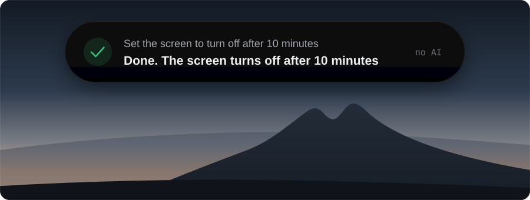

  

  <a href="https://tsukuba-tech.com">tsukuba-tech.com</a>&nbsp;&nbsp;·&nbsp;&nbsp;<a href="mailto:developer@tsukuba-tech.com">developer@tsukuba-tech.com</a>

## About

Tsukuba Tech is a software studio in Japan. We make Leo, a voice assistant that does the work on your Windows PC, and Tanzz AI, the server it thinks with. We also design, build and run websites and business systems for companies in Japan, from the first sketch to the production server.

We keep AI where it earns its place. If a task can be done with plain code, it is done with plain code, because that is faster, cheaper and easier to trust.

## Leo

Leo lives in a small island at the top of your screen. Say "Hey Leo" or type, and it does the task in the apps you already use. Early access opens in 2027.

&nbsp; **Wakes on your PC.** The wake word is recognised offline, so nothing is sent until Leo hears its name.

&nbsp; **Simple things skip the AI.** Around 170 everyday commands, like opening apps, timers, conversions and Windows settings, run locally and instantly.

&nbsp; **Works in your apps.** Leo reads and operates Windows apps and your browser through UI Automation, the accessibility layer Windows already provides.

&nbsp; **Private by default.** Memory, files and history stay on your PC, encrypted with your Windows account. Only what a request needs is sent.

&nbsp; **Asks first.** Every tool has a permission level, and anything risky waits for your approval, on the PC or from your phone.

## Also from Tsukuba Tech

&nbsp; **Tanzz AI.** The server behind Leo. It picks the right model for each task, keeps track of usage, and connects Leo to company knowledge and tools.

&nbsp; **Tanzz Studio.** A CMS for agencies. Describe a business and Studio drafts the content model, the API and a secure frontend to ship.

&nbsp; **Client work.** Websites, dashboards and ticketing systems for businesses in Japan, built and hosted by us.

## Stack

TypeScript and Node.js · Electron · C# and .NET · React and Next.js · SQLite and SQL Server · Docker on Linux

 

  Most of our work is in private repositories. To talk about a project, write to <a href="mailto:developer@tsukuba-tech.com">developer@tsukuba-tech.com</a>

